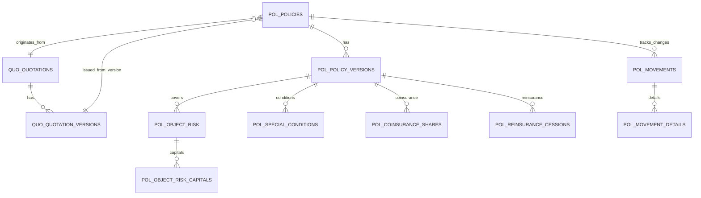
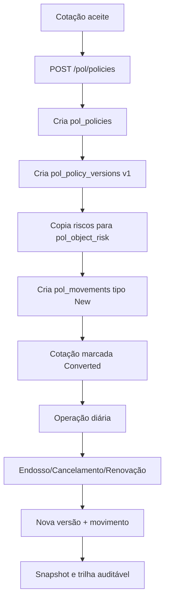

# Roadmap Prático de Apólices (do zero ao mundo real)

## 1) Contexto rápido: onde apólice entra no fluxo

Se você já domina **cotações**, pense assim:

1. Cotação (`quo_quotations` + `quo_quotation_versions`) = proposta técnica/comercial.
2. Quando a cotação é aceite, nasce a **apólice** (`pol_policies`).
3. A apólice vive por **versões** (`pol_policy_versions`), porque no mundo real ela muda com endossos.
4. Cada mudança relevante gera um **movimento** (`pol_movements`) e detalhes (`pol_movement_details`).
5. A cobertura real por objeto fica em `pol_object_risk` (carros, pessoas, bens, etc).

---

## 2) Desenho macro (ER simplificado)

---

## 3) Tabela principal: `pol_policies` (a “capa” do contrato)

### Papel no negócio
É o registro da apólice como contrato principal (número de apólice, cliente, ramo, vigência global, status).

### Campos principais e uso real

- `id`: chave técnica.
- `policy_number`: número comercial da apólice (ex.: `POL-91-2026-00012`).
  Uso real: referência em atendimento, sinistro, cobrança e documentos legais.
- `quotation_id`: cotação de origem.
  Uso real: auditoria e rastreabilidade comercial.
- `quotation_version_id`: versão da cotação que foi convertida.
  Uso real: garante que sabemos exatamente “qual versão foi vendida”.
- `insurance_branch_id`: ramo (Auto, Saúde, etc).
- `customer_id`: segurado/tomador (entidade).   
- `agent_id`: agente/corretor associado.
- `previous_policy_id`: apólice anterior (renovação).
- `renewal_count`: quantas renovações já ocorreram.
- `original_policy_id`: primeira apólice da cadeia de renovações.
- `inception_date`: início da vigência.
- `current_expiry_date`: fim da vigência atual.
- `status`: estado macro da apólice (`Active`, `Suspended`, `Cancelled`, `Expired`, `Terminated`).
- `slug`: identificador amigável/técnico.
- `created_by`, `updated_by`: auditoria interna.
- `timestamps`, `deleted_at`: controle temporal e soft delete.

### Exemplo prático
- Cliente fecha seguro auto anual.
- Cria `pol_policies` com status `Active`, vigência 07/04/2026 a 06/04/2027.

---

## 4) Versões: `pol_policy_versions` (coração da evolução da apólice)

### Papel no negócio
Cada endosso/alteração relevante não “sobrescreve” a apólice: cria nova versão.

### Campos principais e uso real

- `policy_id`: vínculo com apólice.
- `version`: número sequencial (1, 2, 3...).
- `effective_date`: data em que a versão começa a valer.
- `expiry_date`: validade desta versão.
- `commercial_agent_role_id`, `sales_channel_id`, `cae_rate_id`: metadados comerciais/tarifários.
- `net_premium`: prêmio líquido.
- `total_taxes`: total de encargos/impostos.
- `gross_premium`: prêmio total (valor cobrado).
- `currency`, `exchange_rate`, `gross_premium_usd`: multi-moeda.
- `commission_rate`, `commission_value`: comissão do canal/agente.
- `discount_percent`: desconto aplicado.
- `status`: `Active`, `Superseded`, `Cancelled`.
- `snapshot_json`: fotografia imutável da apólice naquele momento.
  Uso real: auditoria, compliance, reimpressão histórica.

### Exemplo prático
- Versão 1: emissão inicial.
- Versão 2: cliente adiciona cobertura (endosso) em 01/06.
- Versão 1 vira `Superseded`; versão 2 vira `Active`.

---

## 5) Riscos cobertos: `pol_object_risk`

### Papel no negócio
É onde a cobertura concreta vive (objeto + cobertura + capital + prêmio).

### Campos principais e uso real

- `policy_version_id`: versão da apólice.
- `object_id`: objeto segurado (veículo/pessoa/imóvel).
- `coverage_id`: cobertura aplicada.
- `source_quo_object_risk_id`: rastreio da origem na cotação.
- Capitais (`dp_capital`, `rc_capital`, `building_capital`, `content_capital`, `exploration_capital`, `capital`).
- `coverage_perc`: percentual de cobertura.
- `applied_rate`: taxa aplicada.
- `coverage_premium`: prêmio da cobertura.
- `rate_origin`, `rate_id`: origem da taxa (manual/tabela).
- `discount_percent`, `surcharge_percent`: ajuste fino tarifário.
- `status`: `Active`, `Suspended`, `Removed`.
- `effective_date`, `end_date`: vigência específica desse risco/cobertura.

### Exemplo prático
- Frota com 3 viaturas:
  - Cada viatura gera múltiplos registros em `pol_object_risk` (uma linha por cobertura).

---

## 6) Capitais detalhados por risco: `pol_object_risk_capitals`

### Papel no negócio
Complementa `pol_object_risk` com capitais por tipo (`DP`, `RC`, `BUILDING`, etc).

### Uso real
- Quando um risco exige granularidade de capitais para cálculos/relatórios/regulatório.

---

## 7) Movimentos: `pol_movements` (trilha operacional da apólice)

### Papel no negócio
Registra os eventos de negócio da apólice.

### Campos principais

- `policy_id`
- `from_version_id` e `to_version_id`
- `movement_type`: `New`, `Renewal`, `Amendment`, `Cancellation`, `Reinstatement`, `Correction`
- `movement_subtype`
- `movement_date`, `effective_date`
- `premium_difference`: impacto financeiro do movimento
- `prorata_days`, `prorata_factor`: cálculo proporcional
- `reason`, `notes`
- `status`: `Pending`, `Approved`, `Rejected`, `Processed`
- `approved_by`, `approved_at`, `created_by`

### Exemplo prático
- Endosso com aumento de prêmio:
  - cria movimento `Amendment`
  - `premium_difference` > 0
  - após validação interna: `Approved`

---

## 8) Detalhe de mudanças: `pol_movement_details`

### Papel no negócio
Explica “o que mudou” dentro de um movimento.

### Campos e uso

- `movement_id`
- `change_type`: `Object_Added`, `Coverage_Removed`, `Premium_Changed`, etc.
- `object_risk_id`, `coverage_id`
- `field_name`, `old_value`, `new_value`
- `premium_impact`

### Exemplo prático
- “Cobertura de vidros adicionada no veículo X”
- “Capital RC alterado de 10M para 15M”

---

## 9) Condições especiais: `pol_special_conditions`

### Papel no negócio
Cláusulas específicas da apólice (inclusões, exclusões, garantias).

### Campos

- `policy_version_id`
- `special_condition_id` (referência de catálogo)
- `condition_type`: `Inclusion`, `Exclusion`, `Clause`, `Warranty`
- `short_text`, `long_text`, `display_order`

### Exemplo prático
- Exclusão para uso profissional do veículo.

---

## 10) Co-seguro: `pol_coinsurance_shares`

### Papel no negócio
Divide participação da apólice entre seguradoras.

### Campos

- `policy_version_id`
- `insurer_id`
- `is_leader`
- `share_percent`
- `share_premium`, `share_premium_usd`
- `external_reference`

### Exemplo prático
- Seguradora A (líder) 60%, Seguradora B 40%.

---

## 11) Resseguro: `pol_reinsurance_cessions`

### Papel no negócio
Cessão de parte do risco para ressegurador.

### Campos

- `policy_version_id`
- `object_risk_id` (opcional, se for por risco específico)
- `reinsurer_id`
- `treaty_reference`, `treaty_type`
- `ceded_percent`, `ceded_capital`, `ceded_premium`
- `retention_percent`, `retention_capital`

### Exemplo prático
- Cessão facultativa de 30% do risco de um veículo premium.

---

## 12) Fluxo real ponta a ponta

---

## 13) Mapa mental para você (saindo de cotações para apólices)

- Se em cotação você pensa em “simulação”, em apólice pense em “contrato vivo”.
- `pol_policies` = contrato macro.
- `pol_policy_versions` = histórico oficial das mudanças.
- `pol_object_risk` = o que está de fato coberto.
- `pol_movements` = por que e quando mudou.

---

## 14) Roadmap de domínio (sugestão de estudo em ordem)

### Fase 1 — Base (1-2 dias)
- Entender `pol_policies` + `pol_policy_versions`.
- Emitir apólice de uma cotação e consultar por ID.

### Fase 2 — Risco e preço (2-3 dias)
- Entender `pol_object_risk` e relação com coberturas.
- Comparar prêmio da cotação vs prêmio da versão da apólice.

### Fase 3 — Operação real (2-3 dias)
- Entender `pol_movements` e `pol_movement_details`.
- Simular 1 endosso e 1 cancelamento.

### Fase 4 — Casos avançados (3-4 dias)
- Co-seguro (`pol_coinsurance_shares`).
- Resseguro (`pol_reinsurance_cessions`).
- Condições especiais (`pol_special_conditions`).

---

## 15) Checklist prático de implementação

- Emissão inicial funcionando (`POST /pol/policies`).
- Consulta detalhada da apólice (`GET /pol/policies/{id}`).
- Endosso criando nova versão (`POST /pol/policies/{id}/amendment`).
- Cancelamento mudando status (`POST /pol/policies/{id}/cancel`).
- PDF público da apólice (`GET /pol/policies/{id}/pdf`).

---

## 16) Regra de ouro

Em apólices, **não apague história**: versione.

Isso protege:
- auditoria,
- disputas financeiras,
- conformidade regulatória,
- rastreabilidade total entre cotação e contrato final.
